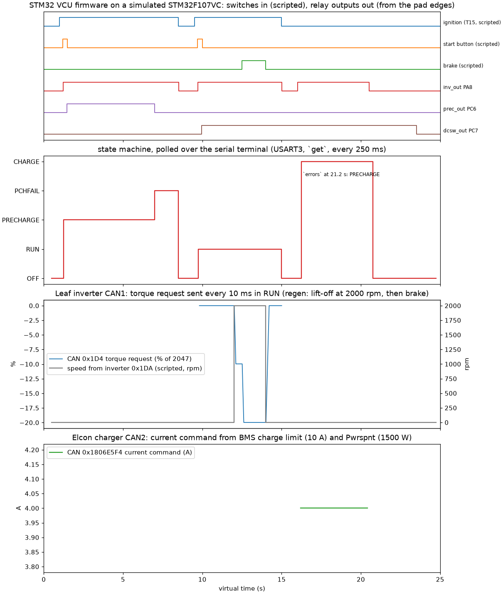

# stm32-vcu (ZombieVerter VCU)

<!-- simantic-banner -->
> **Run this firmware with no hardware.** [Simantic](https://simantic.com) simulates the whole board, peripherals, sensors and buses included. Try it free at **[simantic.com](https://simantic.com)**, or run it locally: `curl -fsSL https://simantic.com/install | sh`

## This fork: the ZombieVerter VCU firmware on a simulated STM32F107

Simantic's fork of damienmaguire's Stm32-vcu. Upstream commit `4f8e69b` (`make get-deps && make`) runs unmodified on a simulated
STM32F107VC (the chip this code is written for) with a Nissan Leaf inverter on CAN1, a SimpBMS battery and an Elcon charger on CAN2,
the key, start button and brake on pads, and a serial terminal on USART3. No board, no car. Everything is in [`sim/`](sim/).

```
cd sim && ./run.sh     # released sim 0.10.8 or later; the plot needs python3 + matplotlib
```

Runs on released `sim` 0.10.8 (build 64f89c38); the numbers below are from that run and are identical to the earlier pre-release run.



**Measured, from a real run** ([`sim/run.log`](sim/run.log), [`sim/measured.txt`](sim/measured.txt); 25 s of virtual time in about 30 s of wall clock):

- Boots and takes terminal commands over USART3 (`set` answers `Set OK`; `get` polls parse into columns; `errors` lists the fault).
- **Precharge failure:** ignition and start button at 1.0 / 1.2 s with no DC voltage reported: inverter power (PA8) at 1.215 s, precharge relay (PC6) at 1.455 s,
  released at 7.005 s (opmode PCHFAIL, `errors` prints `STOP - PRECHARGE`). The 5 s timeout counts in 1 Hz RTC ticks.
- **Drive:** second attempt with 360 V on the inverter's report: start at 9.7 s gives RUN, main contactor (PC7) 250 ms later, and the Leaf messages start:
  0x11A, 0x1D4, 0x1DB, 0x1DC, 0x1F2 at a median 10.00 ms (520 frames each) and 0x50B, 0x55B, 0x59E, 0x5BC at 100.00 ms.
- **Regen:** with the inverter reporting 2000 rpm, 0x1D4 ramps from 0 to -9.97 % (`regenmax` -10 %) on lift-off, then -19.98 % (-409 raw, `regenBrake` -20 set over the terminal) while the brake pad is high;
  back to 0 when the speed returns to 0.
- **Charge:** `set chargemodes 6` at 16.0 s: PRECHARGE then CHARGE; the VCU sends the Elcon command 0x1806E5F4 (extended id) every 200 ms,
  22 frames, 395.0 V and 4.0 A (= `Pwrspnt` 1500 W / 360 V, limited by the BMS charge limit of 10 A that it decoded from 0x351). Ignition-off and charge-off open the main contactor 3.0 s later (23.505 s).
- BMW E46 dash frames (the default `Vehicle` 0): 0x316, 0x329, 0x43B, 0x545 on CAN2 every 10.00 ms while the ignition is on.

**Scripted, not modelled** (no physics plants; all of it is time-tabled stimulus):

- `io_peer.py`: ignition (PD6), start button (PD7) and brake (PA15) at fixed times; HV-request and 12 V inputs tied low, PE3 to PE5 tied high (pull-ups the board has).
- `inv_peer.py`: the Leaf inverter's 0x1DA (DC voltage 0 V until 9.5 s, then 360 V; speed 2000 rpm from 12 s to 14 s) and 0x55A temperatures. The DC voltage step stands in for the HV bus appearing; there is no battery or inverter model.
- `bms_peer.py`: SimpBMS frames with fixed healthy values (3.70 to 3.80 V per cell, 25 C, 10 A charge limit, 360 V).
- `chg_peer.py`: reports back the voltage and current the VCU commanded, once a second.
- `term_peer.py`: the `set` commands and `get` polls.
- `vtor.bin`: the firmware is linked at 0x08001000 for the OpenInverter bootloader, which relocates the vector table. With no bootloader in the sim, the table is preloaded at 0x08000000.

**What does not work / is not shown**

- **No throttle.** This demo does not stimulate the ADC (pyrite#3810, F1 ADC analog input, is fixed in 0.10.8 but not used here), so the pedal,
  temperatures and 12 V all read 0. `potmin` is set to 50 over the terminal so the start condition (`pot` < `potmin`) holds; positive torque, throttle ramp and limiting are not exercised.
- CAN3 (MCP25625 on SPI2), the LIN bus (USART1), the Toyota inverter link (USART2) and the TIM1/TIM3 PWM outputs have no peer: the firmware runs through their init, nothing is checked.
- Only the Leaf inverter, SimpBMS, Elcon charger and E46 vehicle paths are run; the other inverters, vehicles, chargers and CAN-mapped I/O are untried. Flash parameter save is untried.
- The HSE crystal is the 8 MHz chip default; the sim warns the board does not declare it.

**Found in the firmware by this run** (not a sim issue; for the upstream maintainers):

- `prechargeMinTime` in `src/stm32_vcu.cpp` is initialised once and never reloaded, so only the first precharge after boot honours the 1 s minimum. In the second start above the precharge relay (PC6) never closes: the VCU goes PRECHARGE to RUN as soon as the DC voltage is reported, and the main contactor closes with no precharge.
- `VEHMODES` in `include/param_prj.h` says `3=None`, but `enum vehicles` has `None = 4`. `set Vehicle 3` is accepted and changes nothing (`UpdateVehicle` has no case 3).
- With `HVReqFunc` and `PB3InFunc` both defaulting to function 2, the HV-request function maps to the inverted gear input PE5; with the pad floating the VCU reads a permanent external HV request (`chgtyp` 4) and starts precharge by itself. A board with its pull-up fitted is fine.


[](../../actions/workflows/CI-build.yml)

Project based on the OpenInverter System by Johannes Huebner to provide a universal VCU (Vehicle Control Unit) for electric vehicle conversion projects. 

Please visit the development thread on the Openinverter Forum for more information : https://openinverter.org/forum/viewtopic.php?f=3&t=1277


V1.3 Hardware now released. PDFs and Gerber here on Github, full Kicad 9 design is on Patreon at the 10Eur level.

## Required Bootloader

STM32-Serial https://github.com/jsphuebner/tumanako-inverter-fw-bootloader/releases/tag/v5.2

STM32-CAN https://github.com/jsphuebner/stm32-CANBootloader

## Videos on progress

Project introduction : https://vimeo.com/506480876

V1.11a On dyno with GS450h / BMW E39 : https://vimeo.com/802405172

V2.00a now available : https://vimeo.com/824494783?share=copy

V2.15a now available : https://www.youtube.com/watch?v=iwB3wxCEFo0

V2.20A now available : https://www.youtube.com/watch?v=wjlucUWX_lc

V2.40A now available : https://vimeo.com/1201141543?fl=ip&fe=ec

# Supported components

- Nissan Leaf Gen1/2/3 inverter via CAN
- Nissan Leaf Gen1/2/3 PDM (Charger and DCDC)
- Nissan LEAF Battery (all variants)
- Mitsubishi Outlander Support
- Mitsubishi Outlander drivetrain (front and rear motors/inverters) Support
- Modular BMS / SimpBMS Support
- OpenInverter CAN Support
- CCS DC fast charge via BMW i3 LIM
- CCS DC fast charging via FOCCCI https://github.com/uhi22/ccs32clara
- Chademo DC fast charge
- ISA Shunt / BMW SBOX / VW EBOX supported via CAN
- Lexus GS450H inverter / gearbox via sync serial
- Lexus GS300H inverter / gearbox via sync serial
- Toyota Prius/Yaris/Auris Gen 3 inverters via sync serial
- BMW E46 CAN support
- BMW E39 CAN support
- BMW E65 CAN Support
- BMW E31 CAN Support
- Mid 2000s VAG Can support
- Subaru vehicle support
- Opel Ampera / Chevy Volt 6.5kw cabin heater
- VW LIN based 6.5kw cabin heater
- Elcon charger Support
- OBD2 Can support
- TESLA Gen 2 DCDC Converter Can support


# Contributing

Information on how to contribute to this open source project can be found [Contributing Guide](./CONTRIBUTING.md)

# Compiling
You will need the arm-none-eabi toolchain: https://developer.arm.com/open-source/gnu-toolchain/gnu-rm/downloads
On Linux this can be installed by typing:

`sudo apt install gcc-arm-none-eabi`

The only external depedencies are libopencm3 and libopeninv. You can download and build this dependency by typing

`make get-deps`

Now you can compile stm32-vcu by typing

`make`

# Tests

Build the tests

`make Tests`

Run the tests

`./test/test_vcu`

And upload it to your board using a JTAG/SWD adapter, the updater.py script or the esp8266 web interface

I use CodeBlocks IDE :  https://www.codeblocks.org/

Sept 21 : V1 hardware and firmware from "Master" branch now running in my E46 Touring and E39 vehicles.

March 24 : V1.1 Hardware and V2.05A firmware now running in 3 vehicles :

-BMW E39 with Lexus GS450H Drivetrain, Tesla PCS, ISA Shunt , Chademo Fast Charge

-BMW E46 Touring with Nissan Leaf Gen 1 Drivetrain, Outlander Charger / DCDC, ISA Shunt , CCS Fast Charge

-BMW E31 with Tesla LDU Drivetrain, Tesla DCDC, ISA Shunt , Chademo Fast Charge

All hardware / software is tested in these vehicles before release. More vehicles with different configuration in progress to ensure as much testing as possible.

Apr 26 : Added Zombie Relay box V1 full kicad project to hardware directory.
